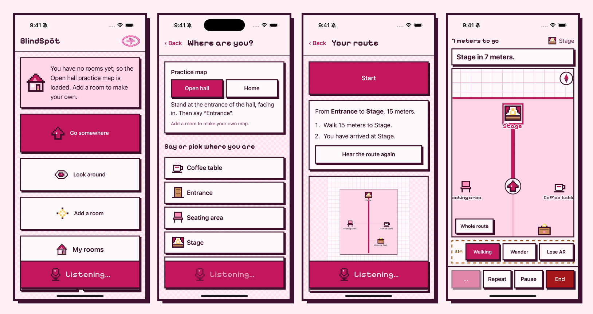

<p align="center">
  
</p>

<p align="center">
  
  
  
  
</p>

**BlindSpöt** is an iPhone app that helps blind and low-vision people find their way indoors. You talk to it, and it talks back.

> A travel aid, not a replacement for a cane or guide dog. It never says a path is clear.

<p align="center">
  
</p>

## What it does

|                           |                                                                                           |
| ------------------------- | ----------------------------------------------------------------------------------------- |
| 🗣️ **Talk to it**         | Press **Talk** anywhere and say _"take me to the stage"_, _"look around"_ or _"go back"_. |
| 🧭 **Go somewhere**       | Turn-by-turn directions by voice, vibration and sound.                                    |
| 👁️ **Look around**        | Warns about obstacles, people and doors in real time, no map needed.                      |
| ✨ **Add a room**         | Scan a room with LiDAR and name it by voice. Rooms join up through shared doors.          |
| 🔔 **Know when to speak** | Rising beep = your turn. Falling beep = heard you. Low beep = didn't catch that.          |

Everything stays on the phone. A practice **Open hall** map is ready until you scan your own rooms.

## Run it

Needs Node 22+, Xcode 16+ and iOS 17. Scanning needs a LiDAR iPhone (12 Pro or later).

```bash
npm install
npm run ios:sync && npm run ios:open   # then press Run in Xcode
```

Try it in a browser, with a simulated scanner and walker:

```bash
npm run dev
```

**Natural voice (optional):** add an ElevenLabs key to `.env.local` (see `.env.example`). Keep builds with a key on your own devices.

## Built with

React · TypeScript · Vite · Tailwind · Capacitor · Swift (RoomPlan, ARKit, Vision, Core Haptics, Speech) · ElevenLabs

| Command                              |                           |
| ------------------------------------ | ------------------------- |
| `npm test`                           | Unit tests                |
| `npm run lint` · `npm run typecheck` | Code checks               |
| `npm run ios:sync`                   | Build and copy into Xcode |

<p align="center">
  
</p>
