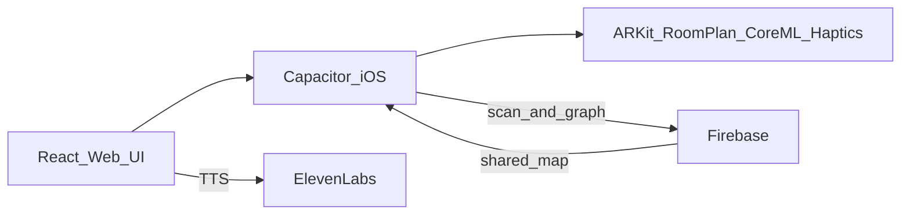

# PathSense PRD (iOS web app)

Working name: **PathSense**. It can be renamed at any time; nothing in the architecture depends on the name.

## Product shape

PathSense runs **only on iOS**. It is still a **responsive web app** (HTML/CSS/React), not a SwiftUI product. It runs in **WKWebView** through **Capacitor**. The UI is web; scanning, AR, haptics and Core ML use native iOS APIs.

Safari on its own cannot give a page LiDAR, RoomPlan, Core Haptics or a reliable AR session. An iOS-only Capacitor shell lets a web UI meet those requirements. **Android, desktop Chrome and public PWA install are out of scope.**

**Target devices**

- **Scan:** iPhone Pro / iPad Pro with LiDAR (12 Pro and later Pro models)
- **Navigate + Map Studio:** iPhone and iPad on iOS 17+ (ARKit world tracking). Phones without LiDAR can navigate maps that other people scanned.
- **Layout:** designed for phones first and comfortable on iPad (responsive). No desktop target in v1.

## 1. Problem

Indoor wayfinding still fails blind and low-vision people in dorms, campus buildings and homes. Outdoor GPS and third-party map apps don't know about rooms, doors, stairs or furniture. Routes drawn by staff go out of date. People end up relying on others, memorizing fragile routes, or traveling without any confirmation of where they are.

**What users need:** a way to scan a real space with the phone (LiDAR) and link scans across rooms and floors. Then they need to walk it with spoken, haptic and gesture-first AR guidance that doesn't require looking at the screen.

## 2. Solution

- **Scan (on phone):** a Capacitor plugin runs ARKit scene reconstruction and RoomPlan. LiDAR builds a mesh of the room and finds its openings. Computer vision (Core ML / Vision on the on-device Neural Engine) labels doors, stairs, people and hazards.
- **Map Studio (in the same responsive web app):** joins scans into a **topological + metric graph** that spans rooms and floors, with live A* routing. No routes are hardcoded and no Google/Apple/Mapbox indoor maps are used.
- **AR navigator (on phone):** ARKit world tracking plus saved `ARWorldMap` / landmark relocalization. A web overlay takes eyes-free gestures over the native AR camera feed. Directions are spoken with ElevenLabs, and haptics use **Core Haptics** (not `navigator.vibrate`).
- **Firebase:** auth, map graphs, scan files and sharing. Cloud Functions run on CPU only. **No external GPU. No cloud ML.**

**How this solves the problem:** the map is the user's own space, and routes are computed from the graph at the moment the user walks. Feedback is non-visual first. iOS sensors make capture and guidance accurate enough to trust.

## 3. Goals and non-goals

**Goals**

- Users can travel indoors on their own in dorms, campuses and homes, using iPhone or iPad.
- Maps are captured by users with LiDAR, routes are computed live, and maps are shared through Firebase.
- Everything works eyes-free: VoiceOver, full-screen gestures, Core Haptics patterns and ElevenLabs speech.
- The web UI is responsive across iPhone and iPad.

**Non-goals (v1)**

- Android, Windows, or macOS Safari as a supported runtime.
- A Safari-only PWA without native plugins.
- A SwiftUI-first native app (the web UI stays the product surface).
- Third-party mapping SDKs, hardcoded routes, or cloud GPU.
- Outdoor GPS or transit.
- Replacing a cane or guide dog (safety copy must say this).

## 4. Users

- **Primary:** blind and low-vision students and residents using an iPhone.
- **Secondary:** a trusted helper who scans a building with a LiDAR iPhone or iPad.
- **Tertiary:** campus or dorm staff who maintain a shared map on an iPad.

## 5. Recommended tech stack (iOS-specific)

**Web UI (the app)**

- TypeScript, React, Vite
- React Router
- Zustand (session state for scan, navigation and Studio)
- TanStack Query (Firebase reads)
- Tailwind CSS plus accessibility tokens (large targets, high contrast, `prefers-reduced-motion`)
- three.js in the webview for Map Studio (RoomPlan mesh preview, floor graph)

**iOS shell**

- **Capacitor** (iOS project only; don't add Android)
- Xcode and Swift plugins, iOS 17 deployment target
- App Store distribution later; TestFlight for class and demo builds

**Native plugins (Swift, on-device)**

- **ScanPlugin:** `RoomPlan` + ARKit scene reconstruction (LiDAR mesh, walls, doors, windows). Exports room parameters and mesh, and runs the audio-guided scan loop.
- **ARNavPlugin:** ARKit world tracking, plane/mesh occlusion, `ARWorldMap` save/load for relocalization, and a pose stream to JS.
- **HapticsPlugin:** custom `CHHapticEngine` patterns (Safari's vibration support is unusable on iOS).
- **VisionPlugin:** Core ML + Vision to detect doors, stairs, people and obstacles, plus `VNRecognizeTextRequest` to read room numbers. Models are compiled `.mlpackage` files running on the Neural Engine. No external GPU.
- **SpeechFallbackPlugin:** `AVSpeechSynthesizer`, used when the device is offline or ElevenLabs fails.

**Voice**

- **ElevenLabs** streaming TTS, called from the web layer
- Clips cached in the Capacitor filesystem / IndexedDB
- AVSpeech fallback

**Spatial map (built in-house, not from a map vendor)**

- Navigation graph: nodes (rooms, doors, landings, POIs) and edges (walkable, length, heading, floor change)
- Scan payload: RoomPlan structure, downsampled mesh, ARWorldMap, CV landmarks
- Stitching in TypeScript: match door ports and stairs, align with Umeyama, user confirms in Studio
- Routing: A* with separate stair and elevator costs (set by user preference)

**Backend**

- Firebase Auth (Sign in with Apple + email link; works with VoiceOver)
- Cloud Firestore (maps, graphs, memberships, versions)
- Cloud Storage (meshes, world maps, models, audio cache)
- Cloud Functions (CPU only: invites, graph validation, quotas; **no ML**)
- Security Rules: owner / org / navigator-only
- Optional Firebase Hosting for legal pages only; the product runs in the iOS app

**Quality and engineering practices**

- Vitest: graph, stitching, A*, haptic pattern specs
- ESLint + Prettier
- GitHub Actions: web unit tests + `xcodebuild` smoke build of the iOS target
- VoiceOver walkthrough checklist
- Privacy: camera and LiDAR data are processed on device; a scan package is uploaded only when the user saves it

## 6. Core user journeys

1. **Scan a room:** on a LiDAR iPhone, an audio coach guides the RoomPlan capture. The app proposes doors and stairs automatically and the user names the room by voice. The draft is saved locally and uploaded on Wi-Fi.
2. **Connect spaces:** in Map Studio on iPhone or iPad, the user snaps doors together, stacks floors, and publishes a map version to Firebase.
3. **Navigate:** the user picks a destination by voice or from a list, and ARKit localizes them. Guidance comes through speech, Core Haptics and AR. A* reroutes if they leave the route.
4. **Share:** invite a roommate, or publish a campus building to an org.

## 7. Features (v1)

**Scanning**

- Audio-guided LiDAR scan
- Door / opening / stair proposals (RoomPlan + Vision)
- Room naming by voice
- Quality meter for coverage and tracking loss
- Local draft; upload to Firebase

**Map Studio (responsive web)**

- Floor canvas: rooms as nodes, doors as ports
- Multi-floor stack and vertical connectors
- Warnings for unmatched doors and disconnected graphs
- POIs: bathroom, exit, RA desk, kitchen
- Version history

**AR navigator**

- Destination search by voice or list (VoiceOver)
- Live A* (no hardcoded routes)
- Turn prompts before each decision point
- Obstacle warnings from Core ML (speech + hazard haptic)
- Arrival confirmation

**Eyes-free interaction**

- Full-screen gesture layer over AR
- Distinct Core Haptics patterns and earcons
- One consistent ElevenLabs guide voice
- Pause / repeat / where am I / nearest exit

**Accounts and sharing**

- Personal and organization maps
- Roles: owner, editor, navigator-only

## 8. Gesture and haptic language

Gestures (full screen; exact touch position doesn't matter):

- Swipe forward: repeat instruction
- Swipe back: cancel
- Swipe left/right: previous/next destination or turn preview
- Double-tap: confirm
- Long-press: stop / hold
- Two-finger swipe up/down: change floor at stairs or elevator

Core Haptics (not the Vibration API):

- Left turn vs right turn (asymmetric patterns)
- Continue straight (steady tick)
- Hazard (sharp triple)
- Arrival (two long pulses)
- Tracking lost (irregular)

Always pair each haptic with speech and its own earcon.

## 9. Data model (sketch)

- `users`, `orgs`, `memberships`
- `maps`, `floors`, `rooms`, `nodes`, `edges`, `pois`
- `scans` (metadata + Storage path for mesh / RoomPlan JSON / ARWorldMap)
- `mapVersions` (immutable graph that the navigator loads)
- The graph JSON is the source of truth for routing; meshes are for visualization and occlusion

## 10. Non-functional requirements

- Relocalize in a cached building in under 3 s when an `ARWorldMap` is available
- Run Vision at interactive rates on the Neural Engine; lower the detection rate when the device is running hot
- Navigation works offline if the map version is cached
- WCAG 2.2 AA for the Studio UI; the navigator is built for VoiceOver and eyes-free use first
- Camera and LiDAR data stay on device, except for scans the user chooses to upload
- Safety: the app complements a cane or guide dog and doesn't replace either
- Info.plist usage strings for camera, motion, speech and haptics

## 11. Milestones

1. **Graph + Studio MVP:** hand-authored graph, tested A*, Firebase, responsive UI in the simulator's Safari/webview.
2. **Capacitor iOS shell:** Core Haptics plugin, gesture layer, ElevenLabs + AVSpeech, VoiceOver pass.
3. **Scan pipeline:** RoomPlan/LiDAR plugin, Vision labels, scan upload.
4. **AR navigator:** ARKit pose + world maps, live A*, rerouting, hazards.
5. **Stitch + share:** door matching, multiple floors, org roles, TestFlight.

## 12. Risks

- Scanning needs LiDAR: non-Pro iPhones can't capture scans, though they can still navigate shared maps. Product copy must say this.
- ARKit relocalization in hallways that look alike: use door and stair landmarks plus world maps.
- WKWebView alongside a native AR view: treat AR as a native full-screen surface under a transparent web gesture overlay, so the AR view keeps 60 fps.
- ElevenLabs latency: prefetch the next two prompts and fall back to AVSpeech.
- Safety: never claim a route is free of obstacles.

## Assumptions

- **iOS only.** No Android.
- **Web UI** (React, responsive) inside **Capacitor**. Not a SwiftUI app, and not a Safari-only PWA.
- LiDAR scanning uses **ARKit/RoomPlan** on Pro devices.
- Firebase is the only backend; ElevenLabs is the only paid voice API.
- PathSense is a working title.
